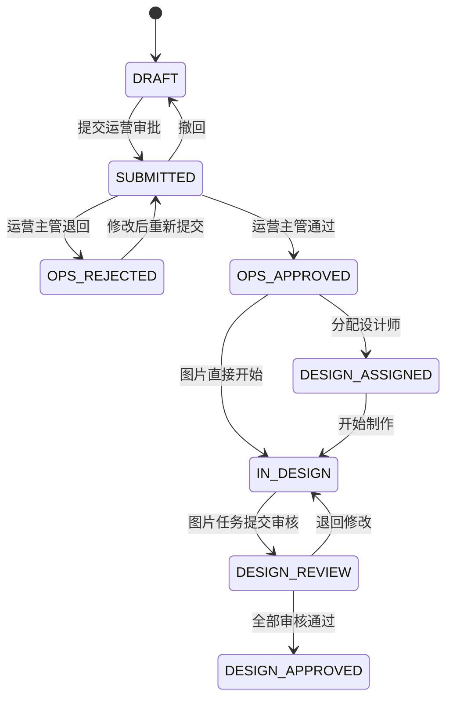
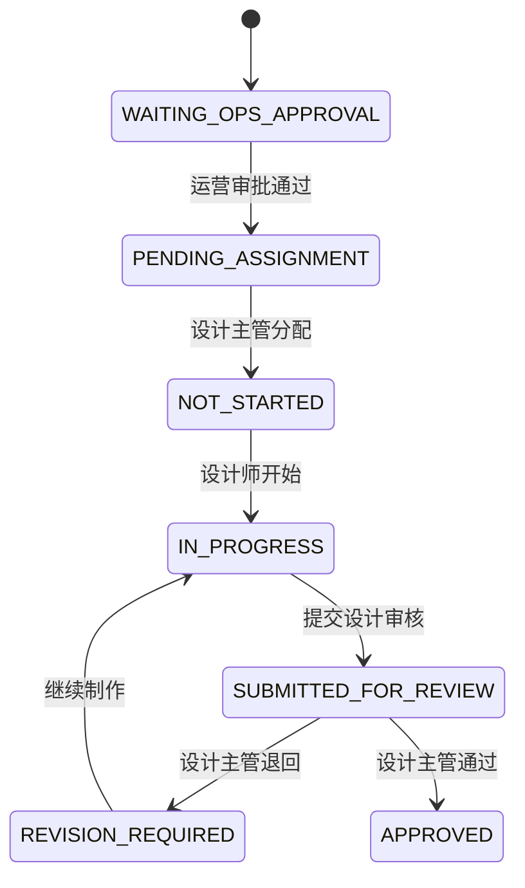

# 天机阁五角色驾驶舱开发前审计报告

## 1. 报告基本信息

| 项目 | 内容 |
| --- | --- |
| 报告名称 | 《天机阁五角色驾驶舱开发前审计报告》 |
| 审计日期 | 2026-07-14 |
| 项目目录 | `C:\Users\zhouhaojie\Documents\天帝宗--天机阁` |
| 当前项目分支 | 无法取得。当前目录不包含 `.git`，不是 Git 工作区 |
| 当前 Git commit | 无法取得。当前目录不包含 Git 元数据 |
| 当前代码版本 | 根项目及两个 workspace 均声明为 `1.0.0`；`SystemConfig.site_version` 当前值为 `V1.0.0 RC-1` |
| 当前代码工作区状态 | 无法用 Git 判定未提交修改；本次开始前未修改任何项目文件 |
| 审计范围 | 五角色权限、导航与路由、Task/ImageTask 状态机、Prisma Schema、真实 SQLite 数据、审批、任务分配、周计划可行性、日志、通知、搜索筛选、时间口径、公共组件和五张预览图组件 |
| 审计基线 | 基于设计主管权限、法旨中心、批量分配、批量审核和驾驶舱修复后的当前代码 |
| 本次是否修改业务代码 | 否。仅新增本报告文件 |

主要证据入口：

- 数据模型：`apps/server/prisma/schema.prisma`
- 法旨可见范围：`apps/server/src/common/task-visibility.service.ts`
- 法旨业务：`apps/server/src/tasks/tasks.service.ts`
- 图片任务业务：`apps/server/src/image-tasks/image-tasks.service.ts`
- 工作流：`apps/server/src/workflow-engine/engine/index.ts`
- 状态机：`apps/server/src/workflow-engine/state-machine/index.ts`
- 驾驶舱聚合：`apps/server/src/dashboard/dashboard.controller.ts`
- 前端导航：`apps/web/src/app/dashboard/layout.tsx`
- 法旨中心：`apps/web/src/app/dashboard/fazhi/page.tsx`
- 法旨详情：`apps/web/src/app/dashboard/fazhi/[id]/page.tsx`

---

## 2. 执行摘要

1. **五角色核心业务流程基本完整。** 运营创建与提交、运营主管审批、设计主管分配、设计师制作、设计主管审核均有真实接口和后端状态校验。
2. **设计主管修复已经生效。** 设计主管能够读取设计阶段法旨、设计师候选人，并执行单条/批量分配、改派、单条/批量设计审核；本报告不建议重做这些能力。
3. **其他四角色驾驶舱不能全部直接按预览图开发。** 当前状态卡和实时待办可以直接开发；涉及“本周计划、本周完成率、每日分配/审核趋势”的组件缺少可靠时间字段。
4. **最大阻碍是历史统计数据模型不足。** `ImageTask` 没有 `assignedAt`、`assignedById`、`reviewedAt`、`planWeek`；运营提交也没有独立提交批次记录。
5. **可直接实现的统计**包括当前状态数量、角色范围内法旨/图片任务总数、当前待审批、待分配、待审核、草稿和退回数量。
6. **受限统计**包括周计划、跨周遗留、每日分配、每日审核通过、首次提交与再次提交、处理率和精确耗时。
7. **需要有限数据库迁移。** 仅周计划和可靠历史趋势需要迁移；当前状态卡、列表、权限和通知不需要迁移。
8. **存在权限风险。** 实际授权主要由角色字符串硬编码，不以 `Permission/RolePermission` 为唯一来源；部分读取接口缺少资源范围校验；未知角色前端菜单存在落入管理员菜单的风险。
9. **存在状态口径不一致。** 前端仍残留未进入后端状态机的 `TECH_REVIEW`、`TECH_APPROVED`、`INVENTORY_PENDING`；`DESIGN_APPROVED` 与 `COMPLETED` 的最终状态语义未统一。
10. **推荐下一步**：先处理 P0 权限/数字一致性/状态口径，再确认周计划迁移，锁定组件统计口径，最后按公共组件、设计师、运营主管、运营、管理员顺序开发。

---

## 3. 设计主管修复结果摘要

| 项目 | 结论 | 依据与说明 |
| --- | --- | --- |
| 法旨中心审批功能 | 已完成 | `ImageTasksService.update()` 限制 `DESIGN_MANAGER` 仅可对 `SUBMITTED_FOR_REVIEW` 执行 `APPROVED/REVISION_REQUIRED`；接口为 `POST /image-tasks/:id/approve-review`、`reject-review` |
| 法旨中心分配功能 | 已完成 | `batchAssign()`、`batchAssignTasks()` 仅允许设计主管/管理员；单任务更新也校验分配状态 |
| 批量审批 | 已完成 | `POST /image-tasks/batch/review-tasks`，校验角色、完成稿和待审核状态 |
| 批量分配 | 已完成 | `POST /image-tasks/batch/assign` 与 `/batch/assign-tasks` |
| 设计师候选列表 | 已完成 | `GET /users/designers` 允许 `DESIGN_MANAGER`，且只返回启用的 `DESIGNER` |
| 多设计师账号显示 | 已完成 | 当前库有 2 个启用设计师；候选接口返回 `userId/name/username/role` |
| 驾驶舱数量与列表数量 | 部分完成 | 状态卡基于数据库；但部分待办/最近列表的卡片数取 `take(8)` 或 `take(6)` 后数组长度，不能替代后端总数 |
| 卡片跳转和筛选 | 已完成但有口径风险 | 复用 `/dashboard/fazhi?scope=design-assignment/design-reviews/design-tasks`；URL 可恢复 scope，但部分 Dashboard 状态链接仍使用通用 status |
| 权限校验 | 已完成但存在风险 | `TaskVisibilityService`、`ImageTasksService` 和附件 Service 有后端校验；权限记录表并不是执行依据，需防止三套规则漂移 |
| 构建和测试 | 本轮未重新执行 | 本任务禁止继续开发/修改；报告基于前序修复后的现有代码和只读数据库核验，不能把未在本轮运行的构建写成新验证结果 |

设计主管现有修复不应被推翻。后续驾驶舱应复用现有 `scope` 和业务接口。

---

## 4. 五角色与权限矩阵

| 角色 | 代码 | 默认首页 | 数据范围 | 核心操作 | 后端校验位置 | 越权风险 |
| --- | --- | --- | --- | --- | --- | --- |
| 管理员 | `OWNER` / `SUPER_ADMIN` | `/dashboard` | 全部非删除法旨及全局配置/日志 | 全局查看、账号和基础数据管理，并可代执行业务动作 | 各 Controller/Service 的 `ADMIN_ROLES` | 可以代执行业务动作，但不能通过标准接口任意跳过状态机；权限过大是设计选择 |
| 运营 | `OPERATION` | `/dashboard` | `Task.creatorId = 当前用户ID` | 新建、编辑草稿/运营退回单、维护图片需求、上传原图/参考图、提交和撤回审批 | `TaskVisibilityService`、`TasksService`、`AttachmentsService` | 后端已限制；“负责”目前不包含可编辑的 `operatorOwner`，只按创建人 |
| 运营主管 | `OPERATION_MANAGER` | `/dashboard` | 全部非草稿正式法旨 | 查看待审批、审批通过、退回、审批回滚 | `TaskVisibilityService.scopeWhere('ops-approvals')`、`WorkflowEngine` | 不能调用设计审核接口；但普通法旨读取范围较广，符合当前“查看全部正式法旨”规则 |
| 设计师 | `DESIGNER` | `/dashboard` | 设计阶段且至少有一张分配给自己的 ImageTask；详情只返回自己的图片任务 | 开始制作、上传完成稿、提交审核、维护设计备注 | `TaskVisibilityService`、`ImageTasksService`、`AttachmentsService` | 后端校验 `designerId`；改派后原设计师不再满足读取条件 |
| 设计主管 | `DESIGN_MANAGER` | `/dashboard` | `OPS_APPROVED` 及后续设计阶段法旨 | 分配、改派未开始任务、审核通过、退回、批量操作 | `TaskVisibilityService`、`ImageTasksService`、`UsersController.designers` | 后端已区分设计权限；不能做运营审批或用户管理 |

明确结论：

- 运营目前只能看到自己创建的法旨，不是“创建或负责”。依据是 `TaskVisibilityService.visibleWhere()` 使用 `creatorId`。
- 设计师只能看到分配给自己的图片任务。列表和详情均在后端使用 `designerId` 过滤。
- 运营主管只能执行运营审批动作；设计主管只能执行设计分配/审核动作。
- 管理员可以查看全局数据，并能代执行业务动作，但仍受当前状态校验，不能通过正常接口直接写任意工作流状态。
- 普通角色修改 URL 后，法旨 scope 会由后端拒绝；但部分管理页主要依赖前端 `RoleGate`，必须继续保留对应后端 Controller 校验。
- `GET /roles-permissions/roles`、`permissions` 当前仅要求登录，没有管理员限制。
- 审批记录接口应补充 Task 数据可见范围校验，避免登录用户通过猜测 taskId 读取不属于自己的审批历史。

---

## 5. 五角色当前导航和页面路由

### 5.1 管理员

| 菜单 | 路由 | 页面守卫 |
| --- | --- | --- |
| 首页 | `/dashboard` | JWT；后端按角色聚合 |
| 法旨中心 | `/dashboard/fazhi?scope=processing` | 后端 Task 可见范围 |
| 店铺管理 | `/dashboard/stores` | `RoleGate` + 后端写接口管理员校验 |
| 需求类型 | `/dashboard/requirement-types` | `RoleGate` + 后端写接口管理员校验 |
| 用户管理 | `/dashboard/users` | `RoleGate` + `UsersController.checkPermission()` |
| 操作日志 | `/dashboard/logs` | `RoleGate` + Audit/OperationLog Controller 校验 |
| 通知中心 | `/dashboard/notifications` | 当前用户 receiverId |
| 反馈管理 | `/dashboard/feedback` | 管理员权限 |
| 系统设置 | `/dashboard/settings` | `RoleGate` + SystemConfig Controller 校验 |

### 5.2 运营

- 首页：`/dashboard`
- 法旨中心：`/dashboard/fazhi?scope=processing`
- 新建法旨：`/dashboard/fazhi/new`
- 我的法旨：当前仍指向 `/dashboard/fazhi?scope=processing`，与法旨中心重复
- 通知中心：`/dashboard/notifications`

### 5.3 运营主管

- 首页：`/dashboard`
- 法旨中心：`/dashboard/fazhi?scope=processing`
- 待我审批：`/dashboard/fazhi?scope=ops-approvals`
- 通知中心：`/dashboard/notifications`

### 5.4 设计师

- 首页：`/dashboard`
- 我的设计任务：`/dashboard/fazhi?scope=processing`
- 通知中心：`/dashboard/notifications`

### 5.5 设计主管

- 首页：`/dashboard`
- 法旨中心：`/dashboard/fazhi?scope=processing`
- 待分配：`/dashboard/fazhi?scope=design-assignment`
- 待审核：`/dashboard/fazhi?scope=design-reviews`
- 设计任务：`/dashboard/fazhi?scope=design-tasks`
- 通知中心：`/dashboard/notifications`

入口真实性：

| 名称 | 当前结论 |
| --- | --- |
| 驾驶舱/工作台/系统控制台 | 使用同一个 `/dashboard` 按角色动态呈现，没有五个独立路由 |
| 法旨中心、我的法旨、新建法旨 | 已存在；“发布法旨”不是当前菜单名称 |
| 审批管理/审核管理 | 没有独立页面，使用法旨中心预设 scope |
| 用户与角色 | 用户管理存在；角色/权限只读接口存在，无可编辑权限页面 |
| 店铺、需求类型、操作日志、系统设置 | 已存在 |
| 消息中心 | 当前名称为通知中心 |
| 资料库、权限配置、数据管理、系统监控 | 当前不存在，不应直接按预览图开发 |

风险：`getMenuItems()` 对未知角色走管理员菜单默认分支，`GUEST` 或异常角色会看见不应显示的入口。后端仍会拦截多数操作，但菜单层不正确。

---

## 6. 法旨状态审计

数据库字段：`Task.workflowStatus String @default("DRAFT")`。

| 状态代码 | 当前显示 | 含义/处理角色 | 允许操作与下一状态 | 主要接口 | 页面 |
| --- | --- | --- | --- | --- | --- |
| `DRAFT` | 草稿 | 运营完善主单和图片需求 | 编辑、删除、提交→`SUBMITTED` | `PATCH/DELETE /tasks/:id`；`POST /tasks/:id/approval/submit` | 我的草稿、详情 |
| `SUBMITTED` | 待运营主管审批 | 运营主管处理 | 运营撤回→`DRAFT`；主管通过→`OPS_APPROVED`；退回→`OPS_REJECTED` | approval withdraw/approve/reject | 待我审批、处理中 |
| `OPS_REJECTED` | 运营主管退回 | 原运营修改 | 编辑、重新提交→`SUBMITTED` | Task update；approval submit | 处理中、详情 |
| `OPS_APPROVED` | 已通过待设计分配 | 设计主管分配 | 分配后按图片状态聚合为 `DESIGN_ASSIGNED` 或 `IN_DESIGN` | ImageTask assign | 待分配 |
| `DESIGN_ASSIGNED` | 已分配设计 | 设计师尚未开始 | 图片开始后→`IN_DESIGN` | `/image-tasks/:id/start` | 设计任务 |
| `IN_DESIGN` | 设计中 | 设计师制作/修改 | 全部提交后→`DESIGN_REVIEW`；部分状态变化继续聚合 | submit-review、review reject | 设计任务 |
| `DESIGN_REVIEW` | 待设计审核 | 设计主管审核 | 退回→`IN_DESIGN`；全部通过→`DESIGN_APPROVED` | approve/reject-review | 待审核 |
| `DESIGN_APPROVED` | 设计审核通过/已通过 | 最终设计完成 | 当前自动聚合终点 | recalcTaskStatus | 已完成归档 |
| `COMPLETED` | 已完成 | 预留最终完成状态 | 状态机无正常自动入口 | 无明确当前业务动作 | 归档筛选兼容 |
| `CANCELLED` | 已取消 | 预留取消状态 | 无当前 API 和 ImageTask 取消逻辑 | 当前不存在 | 归档筛选兼容 |

不存在或不完整的状态：

- “待提交审批”：**当前不存在独立状态**，本质是 `DRAFT`。
- “已取消”：代码常量存在，但当前没有完整业务动作和接口。
- `TECH_REVIEW`、`TECH_APPROVED`、`INVENTORY_PENDING`：前端映射残留，后端状态机不存在。

名称不一致：`DESIGN_APPROVED` 在详情页显示“设计审核已通过”，Dashboard/搜索显示“设计审核通过”；归档语义又接近“已完成”。

---

## 7. 图片任务状态审计

数据库字段：`ImageTask.status String @default("WAITING_OPS_APPROVAL")`。

| 状态 | 显示名称 | 当前负责人 | 操作/流转 | 接口 | 驾驶舱统计 |
| --- | --- | --- | --- | --- | --- |
| `WAITING_OPS_APPROVAL` | 等待运营主管审批 | 运营/运营主管流程 | 运营审批通过→`PENDING_ASSIGNMENT` | Workflow approve | 不属于设计待办 |
| `PENDING_ASSIGNMENT` | 待分配 | 设计主管 | 分配→`NOT_STARTED` | assign/batch assign | 待分配“张” |
| `NOT_STARTED` | 未开始 | 已分配设计师 | 开始→`IN_PROGRESS`；未开始时允许改派 | start/update designer | 设计师待开始 |
| `IN_PROGRESS` | 制作中/设计中 | 设计师 | 上传完成稿仍保持此状态；提交→`SUBMITTED_FOR_REVIEW` | attachment upload；submit-review | 制作中 |
| `SUBMITTED_FOR_REVIEW` | 待设计审核/已提交审核 | 设计主管 | 通过→`APPROVED`；退回→`REVISION_REQUIRED` | approve/reject-review | 待审核，不应计入设计师待处理 |
| `REVISION_REQUIRED` | 退回修改 | 设计师 | 继续制作→`IN_PROGRESS` | start/update | 退回修改；法旨聚合为设计中 |
| `APPROVED` | 已通过 | 流程完成 | 可预留进入`COMPLETED` | 当前审核通过直接写入 | 最终完成“张” |
| `COMPLETED` | 已完成 | 预留终态 | 无当前常规业务入口 | 无明确接口 | 归档兼容 |

明确回答：

1. 独立待分配：有，`PENDING_ASSIGNMENT`。
2. 独立待开始：有，`NOT_STARTED`。
3. 独立制作中：有，`IN_PROGRESS`。
4. 完成稿已保存但尚未提交审核：没有独立状态，仍是 `IN_PROGRESS`。
5. 上传完成稿不会立即进入待审核；必须额外调用提交审核接口。
6. 独立退回修改：有，`REVISION_REQUIRED`。
7. 法旨聚合时退回修改计入 `IN_DESIGN`；驾驶舱可单独展示，但不能与制作中重复相加后再称“总任务”。
8. 已取消：图片任务没有取消状态。
9. 一个 ImageTask 只有一个 `status` 字段，因此同一时刻只能处于一个主状态。
10. 最终审核通过时间没有独立字段，只能从 `AuditEvent/WorkflowHistory.createdAt` 推断；`ImageTask.updatedAt` 不能可靠替代。

---

## 8. 相关数据库表与字段

| 业务对象/表 | 用途与关键字段 | 历史/追踪能力 | 驾驶舱缺口 |
| --- | --- | --- | --- |
| `User` | 用户、启停、角色、强制改密；`roleId/isActive/mustChangePassword/lockedUntil` | 有创建更新时间；无账号过期字段 | 无部门、账号有效期 |
| `Role/Permission/RolePermission` | 单角色关联和权限记录 | 可查询配置记录 | 无后台权限编辑；执行逻辑主要写死在代码 |
| `Task` | 法旨主单；`creatorId/workflowStatus/priority/deadline/storeId` | `createdAt/updatedAt`，软删除字段存在 | 缺提交批次、最终完成时间；`approvedAt` 为 String |
| `ImageTask` | 图片执行单元；`taskId/designerId/status/reviewRemark` | 仅更新时间和日志可推断 | 缺 `assignedAt/assignedById/reviewedAt/planWeek` |
| 设计师分配 | 没有独立表，直接写 `ImageTask.designerId` | `AuditEvent/WorkflowHistory` 可保留部分事件 | 无结构化改派历史、分配时间和分配人字段 |
| `ApprovalRecord` | 运营主管通过/退回/回滚；`taskId/approverId/action/comment/createdAt` | 支持多次主管审批历史 | 不记录运营每次提交事件 |
| 设计审核 | 无独立表，结果在 `ImageTask.status/reviewStatus/reviewRemark` | 日志事件可推断 | 无审核人关系和准确审核时间字段 |
| `Attachment` | 原图、参考图、完成稿；`imageTaskId/category/uploadedById/uploadedAt` | 有上传人和软删除 | 完成稿可多份但无版本模型 |
| `Store` | 店铺基础数据和启停 | 软删除字段 | 可支持数量统计 |
| `RequirementType` | 需求类型和排序/启停 | 软删除字段 | 可支持构成统计 |
| `Notification` | 当前用户通知；`receiverId/taskId/imageTaskId/isRead` | 有创建时间 | 关联多为裸 ID，不是完整 Prisma Relation |
| `AuditEvent` | 当前实际使用的统一审计数据 | 现库 997 条 | metadata 非结构化，可能重复写入 |
| `WorkflowHistory` | 工作流事件历史 | 现库 195 条 | fromState 读取时机导致历史前态可能不准确 |
| `OperationLog` | 旧日志表 | 现库 0 条 | 与 AuditEvent 职责重复，当前未使用 |
| `SystemConfig` | 系统名称、版本、主题等键值配置 | 有 version，但没有独立变更历史表 | 设置页只开放少量键 |

当前数据库支持多次运营主管审批，但不完整支持多次“提交审批”历史；支持重新分配动作，但不以结构化关系保存改派历史；不支持周计划。

---

## 9. 周计划与任务分配审计

- ImageTask 通过 `taskId` 关联法旨，通过 `designerId` 关联设计师。
- 分配通过 ImageTask 更新或批量分配接口完成。
- 当前没有 `assignedAt`、`assignedById`。
- 支持在 `NOT_STARTED` 状态改派；已开始后不允许普通改派。
- 改派历史只能在 AuditEvent/WorkflowHistory 中查找，无法进行可靠关系查询。
- 不存在 `planWeek`、周计划表或周计划明细关联。

| 统计 | 当前判断 |
| --- | --- |
| 设计主管本周团队计划总量 | 可以临时实现，但存在限制；按本周 `image_task.assigned` 事件去重 |
| 本周计划已完成数量/完成率 | 可以临时实现，但存在跨周和改派误差 |
| 本周实际审核通过数量 | 可以临时实现；按审核通过 AuditEvent 时间，但要去重重复日志 |
| 设计师个人本周计划总量/完成率 | 可以临时实现，但需准确解析事件设计师 ID |
| 上周与本周每日审核通过 | 可以临时实现，但日志事件质量和时区必须统一 |
| 本周剩余任务 | 当前无法准确实现；缺固定计划集合 |
| 本周退回修改数量 | 可以临时按退回事件统计，不代表当前仍处于退回状态 |

临时口径建议：

1. 本周计划集合 = 本周首次分配事件发生的 ImageTask，按 ImageTask ID 去重。
2. 本周计划完成 = 上述集合中，截止本周末已由设计主管审核通过的任务。
3. 本周实际完成 = 本周内发生设计审核通过事件的全部图片任务，不限制其分配周。

限制：

- 上周分配、本周继续完成的任务不会进入“本周计划”，但会进入“本周实际完成”。
- 本周改派可能被重复记录，需要按任务 ID 去重，并明确归属新旧设计师。
- 本周追加任务会自动扩大计划分母，无法体现期初计划与追加计划。
- 当前没有图片任务取消状态，不能从计划分母中准确排除取消任务。
- 正式版本应增加周计划实体或至少 `assignedAt/assignedById/planWeek/reviewedAt`。

---

## 10. 运营审批数据审计

- 法旨调用 `POST /tasks/:id/approval/submit` 后从 `DRAFT/OPS_REJECTED` 进入 `SUBMITTED`，进入运营主管队列。
- `ApprovalRecord` 保存主管动作、审批人、意见和时间，支持多次通过/退回/回滚。
- 运营每次提交由 AuditEvent/WorkflowHistory 记录，没有专用提交记录表。
- Task 的 `approvedAt` 只保存最近审批结果，且字段为 String；不适合作为完整历史来源。

| 统计，单位均为法旨“条” | 判断 |
| --- | --- |
| 当前待审批/当前剩余待审批 | 可以准确实现：`workflowStatus=SUBMITTED` |
| 当前待审批需求类型构成 | 可以准确实现：SUBMITTED Task 按 requirementType 分组 |
| 本周审批通过/退回 | 可以按 ApprovalRecord 准确实现，前提是统一 Asia/Shanghai 边界 |
| 本周已完成审批 | 可以按通过+退回记录统计，但同一法旨一周多次处理需明确按次数还是去重法旨 |
| 首次提交/修改后再次提交 | 当前无法从业务表直接准确实现，只能推断 workflow.submitted 事件顺序 |
| 本周收到审批法旨 | 可以临时按 submitted 事件统计，可能受日志重复和历史缺失影响 |
| 每日收到/完成审批 | 可以临时实现，但必须先清理事件口径和时区 |

退回原因和退回人可从 `ApprovalRecord.comment/approverId` 获取；多次审批历史存在。

---

## 11. 运营工作台数据审计

| 组件 | 结论 |
| --- | --- |
| 待我处理 | 可直接开发，但需定义为草稿+退回，不混入纯等待状态 |
| 草稿待完善 | 可准确实现：当前用户 `creatorId` + `DRAFT` |
| 退回待修改 | 可准确实现：当前用户 + `OPS_REJECTED` |
| 待提交审批 | 需要修改名称；不是独立状态，应归入草稿待完善 |
| 我的进行中法旨 | 可准确实现：当前用户正式流程、排除草稿和归档 |
| 待主管审批/待设计分配/设计制作中/待设计审核/已完成 | 可按 Task.workflowStatus 准确实现 |
| 最近法旨进展 | 可用 AuditEvent 临时实现，日志内容不完全统一 |
| 当前处理角色 | 可由 Task 状态映射，不需要新增数据库字段 |

补充结论：

- 运营范围由后端按 `creatorId` 过滤。
- 运营详情接口会返回 ImageTask 的 designer，可以查看具体设计师姓名。
- 运营退回原因/退回人可从审批记录获取。
- 草稿编辑调用 PATCH 修改原 Task，不会主动创建新 Task；只有重复触发创建接口才会新建，前端应继续保持创建请求幂等防抖。

---

## 12. 设计师工作台数据审计

| 组件 | 结论 |
| --- | --- |
| 待开始 | 可准确实现：`NOT_STARTED` |
| 制作中 | 可准确实现：`IN_PROGRESS` |
| 待提交审核 | 需要修改口径；无独立状态，可临时定义为 `IN_PROGRESS` 且已有完成稿 |
| 待主管审核 | 可准确实现：`SUBMITTED_FOR_REVIEW`；不应计入设计师待我处理 |
| 退回修改 | 可准确实现：`REVISION_REQUIRED` |
| 本周新分配、计划、计划完成、剩余、每日分配 | 当前数据只能临时支持或无法准确支持 |
| 每日审核通过 | 可从审核事件临时统计 |
| 当前设计任务/退回修改任务 | 可直接开发，按 designerId 后端过滤 |

权限和操作：

- `ImageTasksService.findByTask/findOne` 在后端校验当前设计师 `designerId`。
- 改派后原设计师不再满足读取条件。
- 设计师可以读取 `reviewRemark`，因此能查看退回原因。
- 上传完成稿、保存设计备注、提交审核是不同操作；上传不会自动提交。
- 不建议为“完成稿已保存”新增主状态；第一版可使用附件存在性作为辅助视图条件。

---

## 13. 管理员能力审计

### A. 已真实存在且可编辑

- 新建账号、修改姓名和角色、启用、禁用、重置密码、删除无业务关联测试账号
- 首次登录强制改密，真实字段为 `User.mustChangePassword`
- 新增/修改/停用店铺
- 新增/修改/停用需求类型
- 系统名称、副标题、描述
- 查看操作日志和反馈

### B. 已存在但只读或编辑不完整

- 角色/权限列表可读取，但没有权限编辑 API 和页面
- 版本、默认主题、默认首页等存于 SystemConfig，设置页未全部开放编辑
- 系统环境、数据库和部署方式仅展示
- 健康接口存在，但没有监控控制台

### C. 当前不存在

- 自定义角色、自定义权限
- 菜单权限配置、数据权限配置
- 审批流程配置
- 数据备份恢复
- 系统监控页面
- 账号过期规则

### D. 未来开发候选

- 权限配置中心、系统监控和备份恢复应在明确 V1 范围后单独设计，不能因为预览图出现就默认开发。

当前管理员控制台可展示真实用户数、启用/停用账号数、店铺数、需求类型数、角色数、系统配置和 AuditEvent 日志。

---

## 14. 日志审计

当前实际日志主表为 `AuditEvent`，现库 997 条；`OperationLog` 表为 0 条；另有 195 条 `WorkflowHistory`。

| 动作 | 覆盖情况 | 说明 |
| --- | --- | --- |
| 新增账号、启用/禁用、修改角色、重置密码 | 已记录/部分记录 | AuditEvent 有动作；before/after 并非每条完整 |
| 新增/修改店铺、需求类型 | 需要补充 | 当前 Service 日志覆盖不完整 |
| 创建、修改、删除法旨 | 已记录 | Service 直接写日志并有部分事件日志，可能重复 |
| 提交、撤回运营审批 | 已记录 | 同时存在业务 action 和 workflow event，统计需去重 |
| 运营审批通过/退回 | 已记录 | ApprovalRecord 另有结构化历史 |
| 分配设计师 | 已记录 | 首次分配和改派动作名称不够明确 |
| 重新分配设计师 | 仅部分记录 | 有 assign 事件，但无结构化 before/after 设计师历史 |
| 上传完成稿 | 已记录 | `upload_completed_attachment` |
| 提交设计审核 | 已记录 | `submit_design_review/resubmit_design_review` |
| 设计审核通过/退回 | 已记录 | 审核日志和状态更新日志可能重复 |

AuditEvent 可以保存操作者、对象类型、对象 ID、动作、metadata、时间；内容、before/after、IP、User-Agent 被放在 metadata 中，不是独立统一列。驾驶舱可以展示最近日志，但不能把所有 action 直接相加作为业务次数，必须先定义去重规则。

---

## 15. 搜索、筛选与分页审计

| 条件 | 当前支持 |
| --- | --- |
| 法旨编号、产品编号、兼容产品/产品名称、店铺、需求人 | 支持，后端搜索 |
| 运营人员 | 仅可使用 requesterName 模糊筛选；没有稳定用户 ID 筛选入口 |
| 设计师姓名 | 不支持 |
| 需求类型 | Query DTO/当前列表未完整支持 |
| 法旨状态、图片任务状态、优先级、店铺 ID | 支持组合筛选 |
| 创建时间、分配时间、审核时间 | 不支持 |

实现结论：

- 搜索、筛选、分页均在后端执行。
- 结果受 `TaskVisibilityService` 数据范围限制。
- 支持 `scope/status/priority/imageStatus/search/page/pageSize` URL 参数恢复。
- 法旨中心卡片可跳入带 scope/status 的列表，但 Dashboard 数字必须统一使用与目标列表相同的 where 条件。
- 列表 `total` 来自后端 `count()`。
- Dashboard 的 `todo/recent` 列表使用固定 take；前端若用数组长度显示总数，会把当前截断数量误当总数。

---

## 16. 时间与时区审计

| 项目 | 当前实现 |
| --- | --- |
| 服务器时区 | 未在应用配置中锁定；当前运行环境是 Asia/Shanghai，但部署后不保证 |
| 数据库存储 | Prisma DateTime/SQLite，序列化为 UTC ISO 语义；部分字段如 Task.approvedAt 为 String |
| 后端统计时区 | 没有统一时间服务和 Asia/Shanghai 边界函数 |
| 前端显示 | 浏览器 `Date/toLocaleString`，受客户端所在地影响 |
| 周起始日 | 未定义 |

风险：

- UTC 与本地时间可能混用。
- 浏览器时区会影响日期展示。
- 周日/周一边界没有统一实现。
- 字符串时间和 DateTime 混用。
- 后续“今日/本周/上周”统计可能产生跨天偏差。

后续统一目标应为 Asia/Shanghai，并由后端生成今日、本周、上周的 UTC 查询边界；前端只展示后端结果。

---

## 17. 五张预览图组件核对

### 17.1 设计主管驾驶舱

| 组件 | 结论 |
| --- | --- |
| 未完成图片任务 | 可直接开发，单位必须是“张” |
| 本周团队任务完成率 | 需要数据库迁移或接受临时事件口径 |
| 上周与本周完成情况 | 当前数据只能临时支持 |
| 设计师本周任务进度 | 需要数据库迁移；只能表达计划进度，不能做排名评分 |
| 待分配任务 | 可直接开发，复用 design-assignment scope |
| 待审核完成稿 | 可直接开发，复用 design-reviews scope |

### 17.2 运营主管驾驶舱

| 组件 | 结论 |
| --- | --- |
| 待我审批法旨 | 可直接开发，单位“条” |
| 本周审批处理率 | 需要修改统计口径，明确按审批次数还是去重法旨 |
| 本周审批流转 | 当前数据只能临时支持 |
| 待审批需求类型构成 | 可直接开发 |
| 待审批法旨 | 可直接复用 ops-approvals scope |
| 最近退回法旨 | 可直接开发，来源 ApprovalRecord |

### 17.3 运营工作台

| 组件 | 结论 |
| --- | --- |
| 待我处理 | 可开发，但限定草稿和退回 |
| 我的法旨进度/状态分布 | 可直接开发 |
| 最近法旨进展 | 当前数据只能临时支持 |
| 草稿待完善 | 可直接开发 |
| 退回待修改 | 可直接开发 |
| 待提交审批独立卡 | 应删除或改名为草稿待完善 |

### 17.4 设计师工作台

| 组件 | 结论 |
| --- | --- |
| 待我处理图片任务 | 可直接开发，排除 SUBMITTED_FOR_REVIEW |
| 本周个人任务完成率 | 需要数据库迁移或临时事件口径 |
| 本周分配与完成情况 | 当前数据只能临时支持 |
| 我的任务阶段分布 | 可直接开发 |
| 当前设计任务 | 可直接开发 |
| 退回修改任务 | 可直接开发 |

### 17.5 管理员控制台

| 组件 | 结论 |
| --- | --- |
| 启用账号、店铺、需求类型、系统角色 | 可直接开发 |
| 账号状态、基础配置概览 | 可直接开发 |
| 最近系统操作、全局业务日志 | 可开发，但日志需去重并统一内容 |
| 权限配置、数据管理、系统监控 | 当前功能不存在；应从预览中删除或标注未建设 |

---

## 18. 公共组件审计

现有可复用：

- 侧边导航/Header：`apps/web/src/app/dashboard/layout.tsx`
- 搜索：`apps/web/src/components/GlobalSearch.tsx`
- 权限守卫：`apps/web/src/components/RoleGate.tsx`
- Loading：`apps/web/src/components/Loading.tsx`
- 空状态：`apps/web/src/components/EmptyState.tsx`
- 错误边界：`apps/web/src/components/ErrorBoundary.tsx`
- 面包屑：`apps/web/src/components/BreadcrumbNav.tsx`
- 工作流时间线：`apps/web/src/components/WorkflowTimeline.tsx`
- Card、Statistic、Progress、List、Tag、Table、Select、Pagination：当前直接使用 Ant Design

建议抽象：

- `DashboardShell`、`PrimaryMetricCard`、`ProgressMetricCard`
- `StatItem`、`BarChartCard`、`StatusDistributionCard`
- `TaskTableCard`、`FilterSelect`、`SearchInput`
- `LoadingState`、`ErrorState`

可直接沿用：`RoleSidebar/DashboardHeader` 可以从现有 Layout 拆分，但不应为了抽象而一次性重构全站。`EmptyState` 已存在，不应重复创建同名组件。

不建议抽象：只在单一角色出现且业务语义强的复合卡片；否则会形成大量布尔属性和角色分支。公共组件应统一视觉和交互，不应封装角色业务查询。

---

## 19. 数据库迁移建议

| 调整 | 解决问题 | V1 必须性 | 历史影响/回填 | 阶段与风险 |
| --- | --- | --- | --- | --- |
| `ImageTask.assignedAt` | 准确统计分配时间 | 周计划若进入 V1 则必须 | 历史可从 AuditEvent 尽力回填，无法保证完整 | 驾驶舱周统计前；低至中风险 |
| `ImageTask.assignedById` Relation | 确认计划来源和分配人 | 建议 | 历史依赖事件回填 | 同上 |
| `ImageTask.reviewedAt/reviewedById` | 最终完成和每日审核趋势 | 周完成率进入 V1 则必须 | 可从审核日志回填部分数据 | 中风险 |
| `WeeklyPlan/WeeklyPlanItem` 或 `planWeek` | 固定周计划集合、追加/跨周任务 | 正式周计划必须 | 历史不建议强制伪造计划，只从启用日生效 | 单独 Migration；中风险 |
| 提交审批记录/扩展 ApprovalRecord | 首次/再次提交和每日收到统计 | 非当前状态卡必需 | 可从 workflow.submitted 尝试回填 | 运营主管周趋势前 |
| 结构化 ReassignmentHistory | 改派历史和人员归属 | 非 V1 必须 | 无法完整回填时保留日志来源说明 | 后续阶段 |

不建议仅为了预览图增加数据库字段。当前状态分布、待办、列表和管理员基础统计不需要迁移。

---

## 20. 风险与阻断问题

### P0：开发前必须解决

1. Dashboard 数字与列表 where 条件必须共用查询定义，禁止使用 `take()` 后数组长度作为总数。
2. 未知/GUEST 角色前端默认管理员菜单，必须改为最小权限菜单。
3. 审批记录等资源读取接口需要 Task 可见范围校验。
4. 清理或禁用前端不存在的状态映射，统一 `DESIGN_APPROVED/COMPLETED` 终态语义。
5. 周计划若作为首批正式功能，必须先确认迁移和统计口径。

### P1：对应角色开发前解决

1. 统一权限来源，至少建立集中角色能力映射，避免菜单、RoleGate、Service 三处漂移。
2. 明确审批处理率按次数还是按唯一法旨。
3. 统一 Asia/Shanghai 时间边界。
4. 区分法旨“条”和图片任务“张”。
5. 明确 AuditEvent 去重规则。

### P2：可暂时接受但必须记录

1. 使用事件日志临时推断本周分配和审核通过。
2. 运营“负责人”当前实际只按 creatorId。
3. 改派历史只有日志，无独立关系表。
4. `OperationLog` 空表和 `WorkflowHistory/AuditEvent` 并存。

### P3：后续优化

- 菜单 query scope 高亮、SystemConfig 编辑完整性、日志 metadata 结构化、统一错误文案和编码清理。

---

## 21. 最终建议

推荐顺序：

1. 修复 P0 权限、状态和数字一致性问题。
2. 产品确认周计划、跨周、改派、追加任务和最终完成状态。
3. 若正式保留周计划，先实施最小数据库迁移并定义历史数据启用日。
4. 锁定五角色最终组件和每张卡的单位、where 条件、目标 URL。
5. 制作准确高保真预览稿，删除当前不存在的权限配置、数据管理、系统监控等入口。
6. 建立共享驾驶舱组件和统一统计 API 结构。
7. 先开发设计师工作台的当前状态与任务列表；周计划模块待字段完成后接入。
8. 开发运营主管驾驶舱，先上当前待审批、构成和最近退回；周趋势后接。
9. 开发运营工作台，复用现有 creatorId 范围和状态筛选。
10. 开发管理员控制台，只展示真实存在的账号、基础数据、配置和日志。
11. 完成五角色菜单、URL、API、数据范围、卡片数字与列表总数回归。

角色开发判断：

- 设计师工作台：状态卡和当前任务可以直接开始；周计划部分不能直接开始。
- 运营主管驾驶舱：当前待审批、构成、最近退回可以开始；本周处理率需先确认口径。
- 运营工作台：基础状态和列表可以直接开始。
- 管理员控制台：真实基础统计可以开始；权限配置、数据管理、监控不能开始。

---

## 22. 报告结论与交付核验

### 当前可以直接进入开发的部分

- 设计师当前任务、待开始、制作中、待审核、退回修改
- 运营主管当前待审批、需求类型构成、最近退回
- 运营草稿、退回、流程状态分布和当前法旨列表
- 管理员账号、店铺、需求类型、角色数量、基础配置、日志概览
- 五角色公共 Dashboard 视觉组件

### 当前不能直接进入开发的部分

- 正式本周计划和完成率
- 跨周计划、每日分配和审核趋势
- 首次提交/再次提交精确统计
- 权限配置、数据管理、备份恢复、系统监控
- 设计师绩效排名、评分和逾期风险预警（产品规则已明确禁止）

### 开发前必须确认

- 周计划集合和追加任务规则
- 改派后的周计划和人员归属
- `DESIGN_APPROVED` 与 `COMPLETED` 的最终状态口径
- 审批处理率按审批次数还是唯一法旨
- 历史周计划是否回填，以及统计启用日期

### 建议删除的预览图组件

- 独立“待提交审批”状态卡
- 权限配置、数据管理、系统监控等当前不存在入口
- 设计师评分、排名、逾期和风险预警

### 建议修改的预览图组件

- 所有卡片明确标注法旨“条”或图片任务“张”
- “本周完成率”改为计划完成率并注明计划集合
- “最近日志”按 AuditEvent 去重后展示
- “已完成”统一映射最终状态

### 建议新增的数据库字段/表

- `ImageTask.assignedAt`
- `ImageTask.assignedById`
- `ImageTask.reviewedAt`
- `ImageTask.reviewedById`
- 正式周计划启用时增加 `WeeklyPlan/WeeklyPlanItem` 或等价计划周关系
- 需要精确运营流量时增加提交审批记录

### 下一条建议发送给 Codex 的任务类型

先发送“P0 权限、状态、统计口径修复与最小迁移方案确认”任务，不要直接发送五角色驾驶舱全量开发任务。

### Git 与文件变更核验

- `git status`：无法执行有效核验，当前目录不是 Git 仓库，Git 返回 `fatal: not a git repository`。
- `git diff --stat`：同样无法取得。
- 本次操作仅新增：`docs/dashboard-audit-report.md`。
- 本次没有修改业务代码、Prisma Schema、数据库、seed、页面或接口。
- 因缺少 Git 元数据，无法排除本次开始前工作区已有的非 Git 文件差异；未对此类文件做任何处理。

